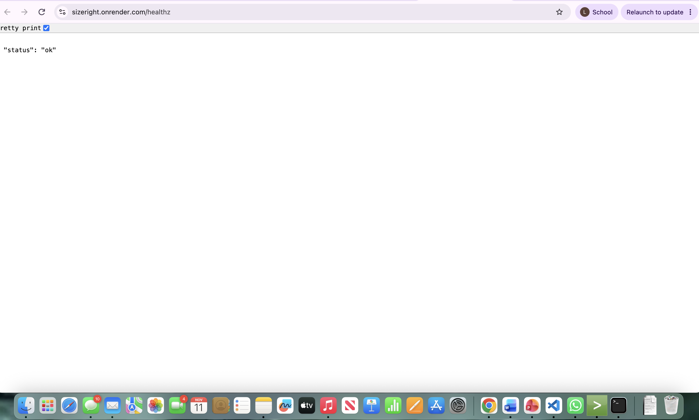
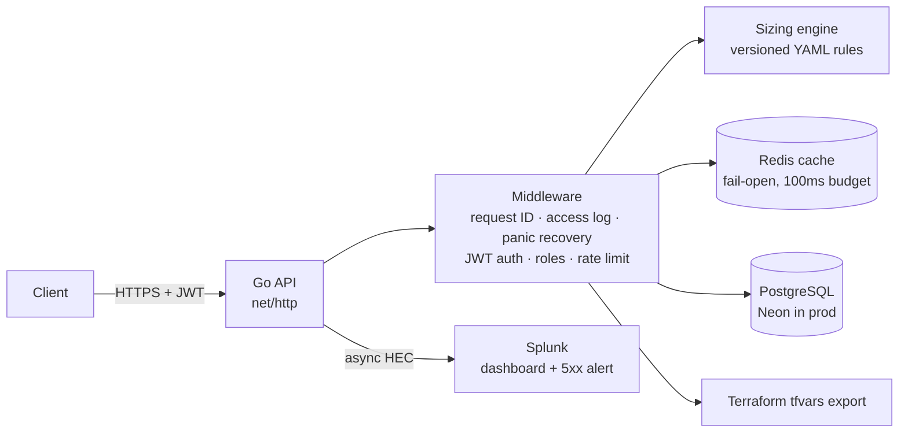
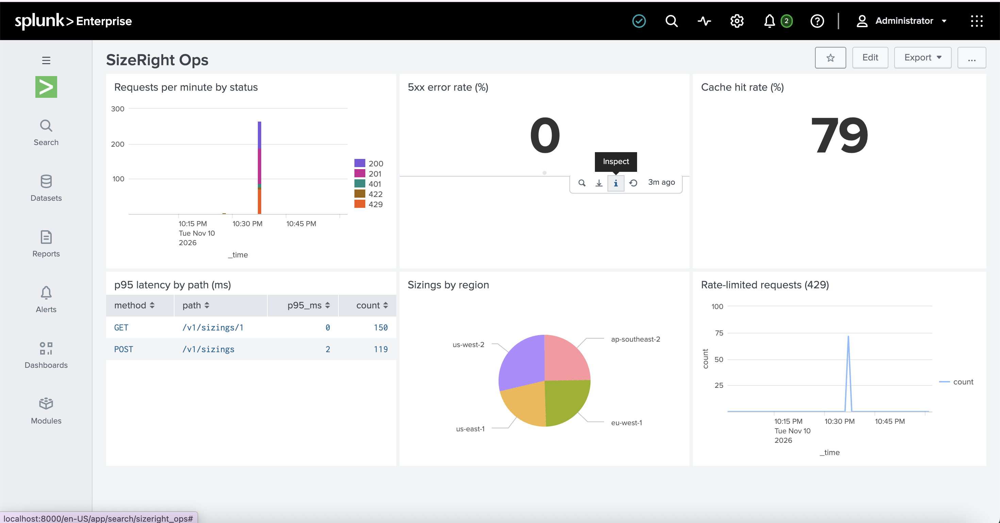
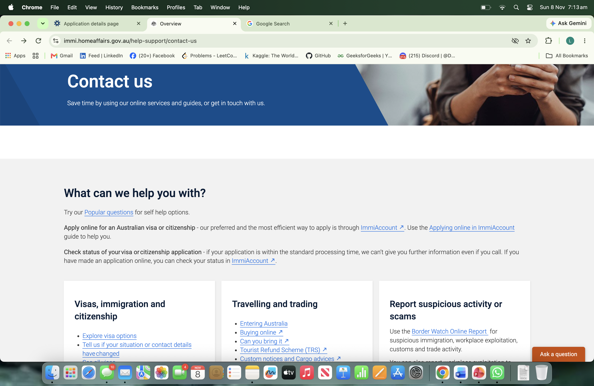

# SizeRight — Splunk deployment sizing API

**Live:** https://sizeright.onrender.com/healthz &nbsp;·&nbsp; **Release:** v1.0.0 &nbsp;·&nbsp; [](https://github.com/Likithaa07/sizeright/actions/workflows/ci.yml)


SizeRight turns a customer's Splunk subscription (ingest GB/day, retention, search load, premium apps) into a deployment plan: how many indexers and search heads are needed, how much storage is required, and why. It then exports Terraform inputs so the infrastructure can be provisioned automatically.

It is built the way a production service should be: authenticated, validated, rate-limited, cached, observable in Splunk, load-tested, and chaos-drilled.

```
POST /v1/sizings  {"ingest_gb_per_day":500, "retention_days":90, "premium_apps":["enterprise_security"], ...}
→ 201 {"indexers":5, "core_search_heads":3, "premium_search_heads":1,
       "local_storage_tb":19.8, "object_store_tb":22.5,
       "explanations":["Enterprise Security enabled: each indexer handles 100 GB/day", ...]}
```



## Architecture



## Results

| | |
|---|---|
| Load test (k6, 400 concurrent users) | **854,789 requests, ~6,300 req/s, 0.00% errors, p95 56 ms** ([details](docs/loadtest.md)) |
| Test coverage (sizing engine) | 87.9%, golden + property tests |
| Chaos drills | DB down ✅ · Redis down (found a bug, fixed) ✅ · bad deploy ✅ ([runbook](docs/runbook.md)) |

## Splunk observability



Structured JSON logs are shipped to Splunk through the HTTP Event Collector by a non-blocking, buffered sender with exponential backoff. The dashboard shows requests/min by status, 5xx error rate, cache hit rate, p95 latency per endpoint, sizings by region, and rate-limited requests. A scheduled alert fires when there are more than 5 server errors in the window.



## The bug the drills found

During the Redis-down drill, every sizing request returned **500** even though the cache was designed to "fail open". The logs showed `duration_ms: 2001` and `context deadline exceeded`: the Redis client retried its connection 5 times per call, which used up the request's whole 2-second budget before the Postgres insert ran.

**Fix:** each cache call gets its own 100 ms budget, client retries are disabled, and a regression test (`TestRedisDownFailsFast`) enforces it.
**Lesson:** an optional dependency must not only fail *open*, it must fail *fast*. Full write-up: [postmortem](docs/postmortem-redis-outage.md).

## Security

- JWT auth (HS256, expiry required) with roles: `viewer`, `sizing_engineer`, `admin`
- Ownership checks on every read; non-owners get **404** (not 403), so IDs can't be probed (IDOR protection)
- Strict input validation: unknown JSON fields rejected, 1 MB body limit, bounded values → 400 / 422
- Per-user token-bucket rate limiting → 429 + `Retry-After`
- Secrets only from environment variables; `.env` is git-ignored; gitleaks + govulncheck run in CI
- Errors return a `request_id`, never a stack trace

## API

| Method | Path | Role | Description |
|---|---|---|---|
| GET | `/healthz` | — | Process alive |
| GET | `/readyz` | — | 200 if the database is reachable, else 503 |
| POST | `/v1/sizings` | sizing_engineer, admin | Create a sizing |
| GET | `/v1/sizings/{id}` | owner or admin | Read a sizing |
| GET | `/v1/sizings/{id}/terraform` | owner or admin | Download `terraform.tfvars.json` |

## Run it locally

```bash
cp .env.example .env              # then fill in values
docker compose up --build         # Postgres + Redis + migrations + API on :8080
TOKEN=$(go run ./cmd/devtoken -user alice -role sizing_engineer)
curl -X POST localhost:8080/v1/sizings -H "Authorization: Bearer $TOKEN" \
  -H "Content-Type: application/json" -d @examples/sizing.json
go test -race ./...
```

## Tech stack

Go 1.27 · net/http · PostgreSQL (pgx) · golang-migrate · Redis · JWT · Docker (distroless, 9.5 MB) · GitHub Actions · Terraform (AWS) · Splunk Enterprise (HEC, Dashboards, Alerts) · k6 · Render + Neon

## Deployment

- **Production:** Docker image on Render (Singapore) + Neon serverless Postgres (Singapore). Free tier, so the app sleeps after 15 minutes idle and the first request takes ~1 min to wake.
- **CI/CD:** every PR runs gofmt, go vet, `go test -race`, govulncheck, gitleaks, terraform validate and a Docker build. `main` is branch-protected and requires CI to pass. Render deploys `main` automatically.

## Docs

[Design doc](docs/design.md) · [Load test](docs/loadtest.md) · [Runbook](docs/runbook.md) · [Postmortem](docs/postmortem-redis-outage.md)

## Next steps

- Circuit breaker around Redis
- Ship production logs to Splunk Cloud
- `terraform apply` into a real AWS sandbox
